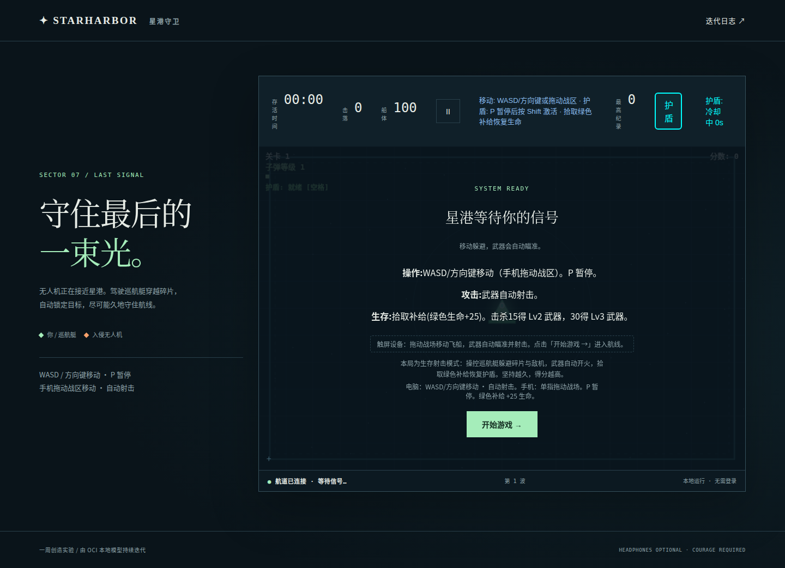
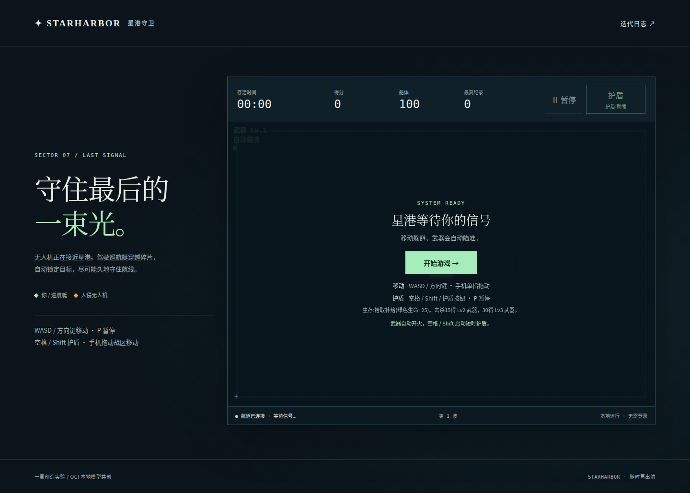
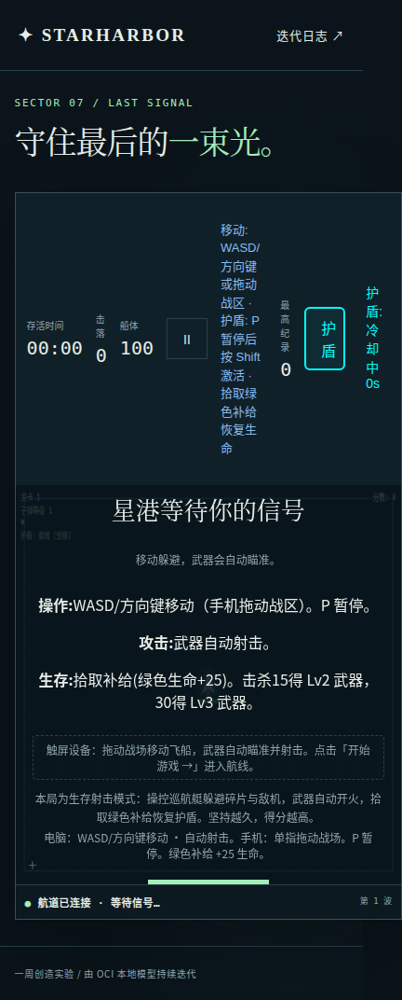
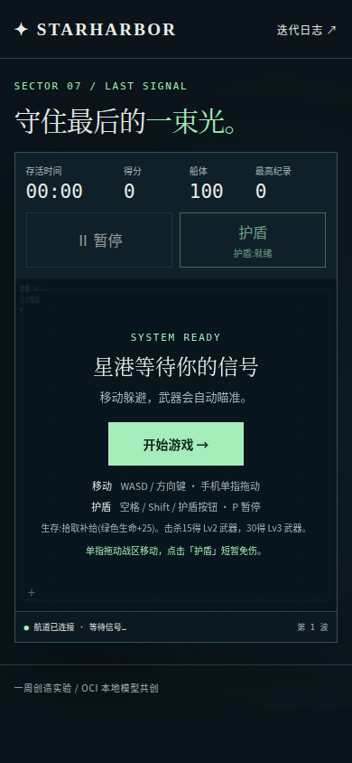
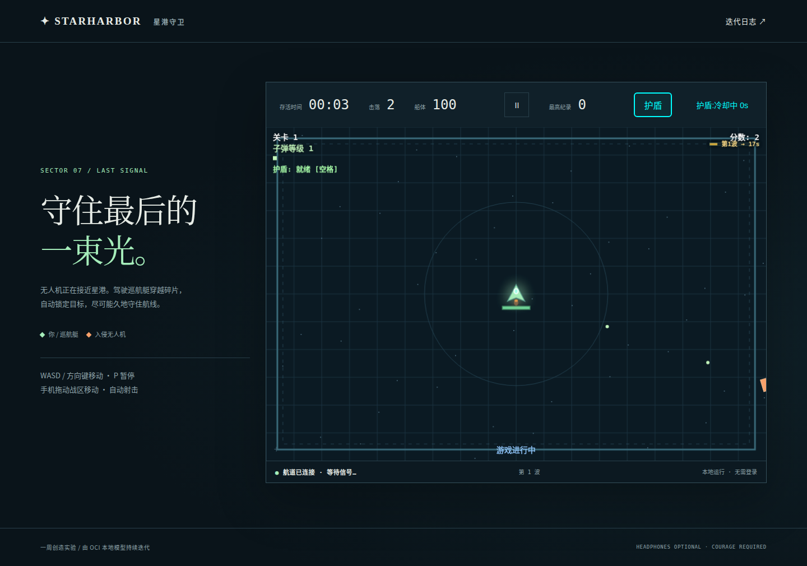
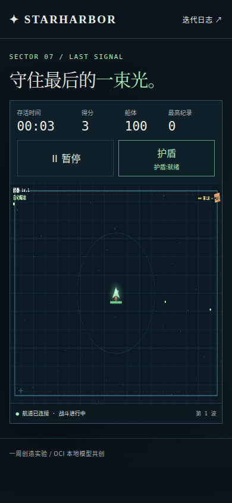
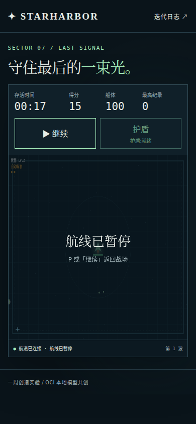

# 星港守卫体验审查与优化发布

2026-10-29 对第 433 轮已发布版本 `f73491a7328a` 做现场审查，完成维护优化并发布 `c9d01fb513fb`。线上地址：[星港守卫](https://game.doufei.eu.org/)，发布资源目录为 `00434-c9d01fb513fb`。

保留既有深色星港风格和玩法，复用原生 HTML/CSS、Canvas、Playwright 1.64，不增加依赖。本次是人工维护发布；Agent 的累计成功 45 次、失败 381 次和 434 轮记录不增加，原周期仍于北京时间 2026-10-29 15:24 结束。

## 审查步骤与结果

| 步骤 | 操作与证据 | 原问题 | 发布后状态 |
| --- | --- | --- | --- |
| 1 | 桌面和手机进入开场页，观察 HUD、操作说明和开始按钮；截图 01、02、04、05 | 手机 HUD 被长说明挤成竖排，布局撑宽，开始按钮被战区裁切；说明重复；页头设置 `pointer-events:none` 导致链接无法点击 | 四项统计与两项操作分区，手机排成两行；开始按钮置于说明前；页头链接恢复点击；六种视口的真实按钮命中检查通过 |
| 2 | 开始战斗，检查移动、护盾、计时和绘制；截图 03、06 | 按钮和 Shift 直接改 `shield.active`，没有进入核心持续时间和冷却逻辑；空格提示与实现不符；就绪时误报“冷却中 0s”；HUD 与画布重复显示多项状态 | 按钮、空格、Shift 统一提交 `input.shield` 到 `core.step`；持续 1.2 秒、从激活起冷却 4 秒；激活和冷却阶段禁止重复启动；统一就绪/生效/冷却文案；绘制保留武器与波次提示，减少重复信息 |
| 3 | 暂停、继续、手机实际战败与重开；截图 07 及浏览器测试 | 自动化只在关掉开场层后检查页面宽度，漏掉开场和手机结算入口；底部状态始终停在“等待信号” | 暂停冻结时间与护盾冷却；继续按钮和状态明确；手机真实进入结算后可点击重开，恢复 100 船体、零冷却和未暂停状态；状态栏随阶段更新 |

## 前后截图

所有图片均在本次审查中直接捕获并检查。桌面开场前后采用 1440×900 视口，手机前后采用 390×844 触控视口；截图采用整页模式，图片高度会随内容变化。

### 1. 桌面开场

优化前：

已发布版本：

### 2. 手机开场

优化前，说明竖排且开始按钮被裁切：

已发布版本，统计、操作、开始按钮和说明都完整可见：

### 3. 战斗与暂停

原桌面战斗画面，护盾同时出现“就绪”和“冷却中 0s”：

已发布版本手机战斗画面：

已发布版本手机暂停画面：

## 验证

- 54 项 Python 运行器测试、18 项 Node guard/验收测试通过。
- 当前游戏 6 项核心测试通过，包含约 200 秒实际规则模拟、致死碰撞与补给边界。
- 既有功能与保留用例回归通过：桌面键盘、手机触控、真实战败与战绩持久化、精英、升级、补给、波次、暂停恢复、Canvas 栈和变换矩阵、运行时异常及离线资源。
- 新增 `experience-review` 检查 320×740、390×844、768×1024、844×390、1280×720、1440×1000 六种视口；验证开场实际宽度、HUD 高度、页头链接、开始按钮中心命中、手机结算重开。
- 新增真实 Space、Shift、鼠标点击、手机 tap 护盾路径；验证激活、到期、冷却期间拒绝再激活、暂停冻结冷却、冷却结束后重新使用。测试通过用户输入触发，不修改游戏快照或直接改内部状态。
- 旧发布版在新增手机开场布局回归中失败，修复版通过；新增护盾就绪用例在旧版失败、新版通过。
- 只修订一条错误旧契约：开战时护盾按钮 title 应含“就绪”，原来固定要求“冷却中”。迁移原因和前后内容保存在 [contract-migrations.json](../../../game-agent/maintenance/2026-10-29/contract-migrations.json)，其他既有契约继续回归。
- 发布后线上 HTTP 200，实际加载同一版本资源；手机实测页面宽度 390px、无横向溢出、Canvas 变换矩阵归一；暂停时间与冷却冻结。

## 交付与边界

完整维护源码、契约和说明位于 [maintenance/2026-10-29](../../../game-agent/maintenance/2026-10-29)。服务端沿用不可变目录和原子指针切换，旧版本及发布前异机加密备份保留。发布事件单独标为 `maintenance`，未恢复自动迭代或延长截止时间。

本次验证使用 Chromium 和模拟触控设备，未在真实 iPhone/Safari、Android 浏览器逐一验证，也未做完整屏幕阅读器或 WCAG 合规测试。没有新增关卡或重新调整整体难度；长期玩法深度、移动端战区比例和模型迭代成功率属于后续独立工作。
